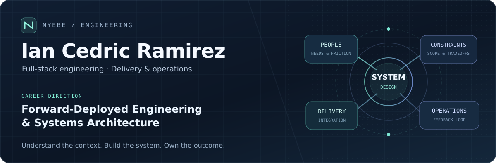
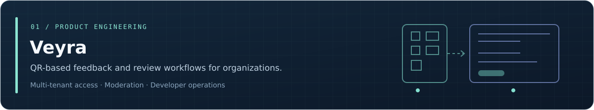
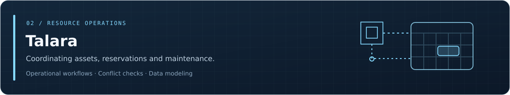
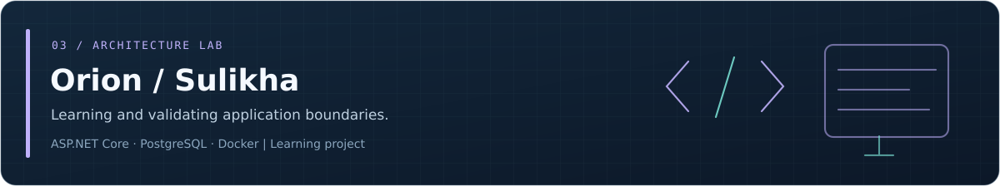

<!-- GitHub profile repository: nyebe/nyebe -->

  

  <a href="https://ianramirez.nyebecreations.click/">Portfolio</a>
  &nbsp; · &nbsp;
  <a href="https://ianramirez.nyebecreations.click/pages/projects/">Case Studies</a>
  &nbsp; · &nbsp;
  <a href="https://www.linkedin.com/in/ian-cedric-ramirez/">LinkedIn</a>
  &nbsp; · &nbsp;
  <a href="mailto:ramirezian037@gmail.com">Email</a>

### About

I work across **application development, backend workflows, and delivery operations**, currently as a full-stack engineer with additional DevOps responsibilities. My professional direction is **forward-deployed engineering and systems architecture**—understanding real-world needs, integrating services, making tradeoffs explicit, and supporting systems after delivery.

I prefer to work from **context → constraints → implementation → observation**, rather than treating a framework or an architecture pattern as the answer before the problem is understood.

### Selected work

Project cards link to published case studies. Source repositories may be private. Orion / Sulikha is a learning laboratory, not a production deployment.

### Engineering in practice

| Context | Work |
| :--- | :--- |
| **Application modernization** | Maintain and improve an employer-owned **HR Assessment & Evaluation System**, including backend workflows, issue investigation, and documentation. |
| **Delivery & operations** | Work with Docker, GitHub Actions, deployment support, and repeatable development environments. |
| **System organization** | Explore modular design, access control, data boundaries, and maintainability through application work and independent projects. |

### Background

- **People Dynamics Inc.** · Full-Stack Engineer, with DevOps responsibilities · 2025–present
- **FEU Institute of Technology** · Full-Time Instructor (software development) · 2023–2025
- **ILTN Holdings LLC** · Web Development & IT Operations (contract) · 2025

[Full experience and case studies](https://ianramirez.nyebecreations.click/pages/experience/)

### Technologies I work with

**Applications:** TypeScript · JavaScript · PHP · React · Vue / Nuxt · Yii2 · REST APIs  
**Data:** PostgreSQL · MySQL · SQL · Redis  
**Delivery:** Docker · Git · GitHub Actions · Linux · Vercel · Appwrite  
**Developing further:** AWS · C# / ASP.NET Core · System design · Infrastructure operations

---

  <b>Open to opportunities</b> in forward-deployed engineering, systems engineering, backend development, and DevOps-aligned roles. 
  Manila, Philippines · Remote / on-site / relocation considered

